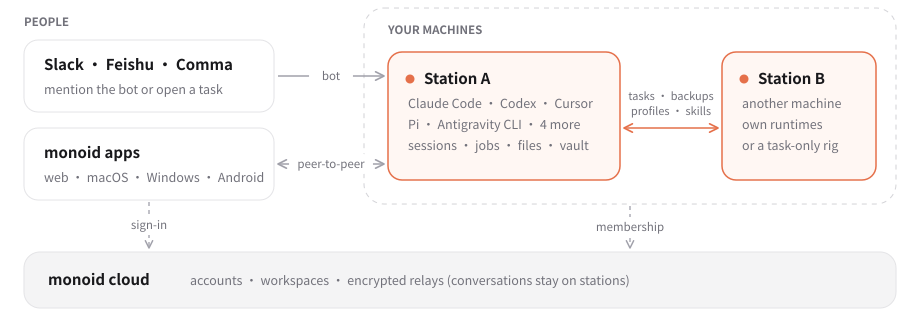

<a href="https://monoid.build"></a>

<p align="center">
<a href="https://monoid.build"><b>Website</b></a> ·
<a href="https://app.monoid.build"><b>Web app</b></a> ·
<a href="#download">Download</a> ·
<a href="#get-started">Get started</a> ·
<a href="#how-it-works">Architecture</a> ·
<a href="https://monoid.build/status">Status</a> ·
<a href="README.zh-CN.md">简体中文</a>
</p>

<p align="center">
<a href="LICENSE"></a>


</p>

**monoid joins the coding agents on all your computers into one.** Every computer you add runs a local **station**. The agents signed in on every station (Claude Code, Codex, Cursor, and [six more](#agents-and-providers)) share one account pool. Your team works with them in Slack, Feishu (Lark), [Comma](https://comma.surf), or monoid's own chats on any device. Chats, files, and jobs stay on your stations, and clients reach them peer to peer.

## What you get

- **One account pool across every station.** Accounts signed in on every station in a workspace act as one pool. New chats pick a working account with the chosen model that resets soonest and has the most quota left. Per-account concurrency limits queue overflow, and accounts can fall back to API keys or Vertex AI. When a chat moves to another account, the agent reads its history back.
- **One team, wherever you already talk.** Mention the bot in a Slack thread or a Feishu (Lark) group, bring a station's agents into a Comma Task, or start a chat in the app. Everyone in the workspace shares the same chats, stations, jobs, team skills, presets, and `MEMORY.md`. Share a single chat outside the workspace with an end-to-end encrypted read-only link.
- **Computers that work as one.** Stations run on macOS, Linux, Windows, and Docker. Agents run tasks and open chats on other stations, syncing only changed files, and borrow profiles and skills across the mesh. Add task-only stations (**rigs**) for owner-approved compute, attach Google Colab GPU sandboxes, or migrate chats and accounts live between stations.
- **Your machine and devices, from anywhere.** Browse and share files, view and drive a station's desktop or browser, open remote terminals (beta), or complete a CLI sign-in from a card in the app. Attach USB devices via adb, serial ports (macOS and Linux), or network devices, or lend your Android phone so agents test on a virtual screen while you keep using it.
- **Persistent sessions and backups.** Each chat keeps its working directory, history, and memory. Builds, watches, scheduled jobs, and web previews keep running after a turn ends and report back when done. Chats copy automatically to two other workspace stations over the encrypted mesh, and optionally to your own R2/S3 bucket with end-to-end encryption.
- **Peer to peer, local-first.** Clients connect to stations over [iroh](https://github.com/n0-computer/iroh), directly on the local network or through an end-to-end encrypted relay, with no inbound ports or VPNs. Conversations and files stay on your stations, never in the cloud database.
- **Optional safe mode and credential vault.** Turn on safe mode so members, devices, and stations require signatures from trusted devices. The cloud alone cannot grant access. An encrypted vault holds API keys and website logins and releases them to an agent only after a person approves.

## Agents and providers

Use each runtime's own subscription login, a provider API key, or a local model server.

| Category | Supported |
| --- | --- |
| **Agent runtimes (9)** | Claude Code, Codex, Cursor, Devin, Grok Build, DeepSeek Harness, Hermes Agent, Antigravity CLI, Pi |
| **Model providers and gateways** | OpenAI, Anthropic, Google Gemini, Google Vertex AI, xAI, Mistral, DeepSeek, Qwen, Kimi / Kimi Code, Z.ai, MiniMax, Xiaomi MiMo, Ant Ling, OpenRouter, Vercel AI Gateway, OpenCode Zen / Go, Command Code, Open Design, Cloudflare AI Gateway, Azure OpenAI, Cloudflare Workers AI, Groq, Together AI, Fireworks, Cerebras, Hugging Face, NVIDIA, Baseten (plus China endpoints for Qwen, Kimi, Z.ai, and MiniMax) |
| **Local and custom endpoints** | Ollama, custom OpenAI-compatible or Anthropic-compatible HTTP endpoints |
| **GPU sandboxes** | Google Colab (G4, L4, T4) via your own Google Colab accounts |

## Download

| Platform | Client | Notes |
| --- | --- | --- |
| **Web** | [app.monoid.build](https://app.monoid.build) | Nothing to install. Works on Linux, iPhone, and iPad (add to home screen). |
| **macOS** | [Download](https://app.monoid.build/releases/latest/mac) | Apple silicon desktop app. |
| **Windows** | [Download](https://app.monoid.build/releases/latest/win) | x64 desktop app. |
| **Android** | [Download](https://app.monoid.build/releases/latest/android) | Phone app. Supports virtual-screen debugging for agents. |

Free for now. Agents use your own subscriptions or API keys.

## Get started

1. Open the [web app](https://app.monoid.build) or a native app above and create a workspace.
2. Select **Add station** and run the enrollment command on the computer that will run your agents.

   **macOS (Apple silicon) and Linux (x64, arm64):**

   ```sh
   curl -fsSL https://app.monoid.build/install.sh | sh -s -- <token>
   ```

   **Windows (x64, PowerShell):**

   ```powershell
   & ([scriptblock]::Create((irm https://app.monoid.build/install.ps1))) <token>
   ```

   **Docker (x64, arm64):**

   ```sh
   docker run -d --restart unless-stopped -v stillfail:/home/stillfail -e STILLFAIL_ORIGIN=https://app.monoid.build ghcr.io/afk-surf/stillfail-station <token>
   ```

3. Sign in to one of the [supported agents](#agents-and-providers) on that station, or add a provider API key. That account joins the pool.

   > [!NOTE]
   > Agent runtimes and their accounts are separate from monoid. Agents run with that computer's OS user permissions. Read the [trust boundary](SECURITY.md#trust-boundary) before enrolling a machine.

4. Start a chat in the app, or connect a Slack, Feishu (Lark), or Comma bot to the station and mention it in a thread.

## How it works

<picture>
  <source media="(prefers-color-scheme: dark)" srcset="docs/images/architecture-dark.svg">
  
</picture>

- **Station (`station/`).** TypeScript on bundled Node with prebuilt native parts (Rust launcher, runner, mesh, and screen, plus Swift Helper on macOS) and a MoonBit reader/builder. It keeps agent sessions alive across restarts, connects outbound to Slack, Feishu, and Comma, and stores chats in local SQLite. Nothing reaches a station from outside except over the encrypted iroh mesh.
- **Workspace and cloud (`cloud/`).** A workspace groups people and stations. The cloud (Cloudflare Workers or self-hosted `workerd`) is the account system and nothing else: accounts, workspaces, member credentials, station registry, and encrypted relays. Chat content never passes through its database.
- **Clients (`apps/mbui/`, `client/core-ts/`).** One cross-platform app for Android, iOS, macOS, Windows, Linux, and the web, built in MoonBit on `libs/ui` (`ui.monoid`). Every client shares the TypeScript client core (`client/core-ts/`), which caches workspace state locally and syncs with stations over the mesh.

## Repository

| Path | Contents |
| --- | --- |
| `station/` | Station daemon (agent runtimes, Slack/Feishu/Comma, jobs, files, screens, vault), native parts (`station/native/`), MoonBit reader (`station/mb/`), and Docker setup (`station/docker/`) |
| `client/` | Shared client core (`core-ts/`), Rust native shell (`shell/`), browser iroh (`iroh-wasm/`), and translations (`i18n/`) |
| `apps/mbui/` | Cross-platform app (Android, iOS, macOS, Windows, Linux, web) built on `libs/ui` ([README](apps/mbui/README.md)) |
| `apps/extension/` | Chrome and Edge extension to send browser pages, links, and selections to a chat ([README](apps/extension/README.md)) |
| `libs/` | `ui` (mbui framework and component library), `comma-ui`, `base` (MoonBit base), `client-core`, and `mesh-transport` |
| `pion/` | Active Pion migration workspaces (`app`, `station`, `ui`, `client-core`, `rules`, `base`, `tools`) |
| `web/` | Web host for the mbui app plus sign-in, share, preview, and admin pages |
| `website/` | Official sites: [monoid.build](https://monoid.build) and [ui.monoid.build](https://ui.monoid.build) |
| `cloud/` | Accounts, workspaces, relays, releases on Cloudflare Workers, and [self-hosted `workerd`](cloud/selfhost/README.md) |
| `rules/` | Shared lock and vault verification rules for station, cloud, and core (MoonBit compiled to JS, plus Tamarin protocol model) |
| `shared/` | Shared TypeScript modules (locks, deltas, release signing, rules runtime) |
| `bin/` | Station launcher and admin CLI scripts |
| `scripts/` | Repository checks, release tooling, and CI planning |
| `design/` | Brand assets and icons |
| `docs/` | Development and operations guides, diagrams, and release notes (`docs/releases/`) |
| `test/` | Integration and browser tests |
| `vendor/` | Patched third-party code |

## Build from source

Requires Git, Python 3, Node.js 24+, and pnpm 10.33.0. Run the cloud test suite with no external accounts or deployment credentials:

```sh
git clone https://github.com/AFK-surf/monoid.git
cd monoid
pnpm install --frozen-lockfile
cd cloud && pnpm install --frozen-lockfile && pnpm run types && pnpm test
```

- **Local stack and native builds:** [docs/development.md](docs/development.md) covers toolchains, an isolated local control plane with mock sign-in, a local `iroh-relay`, disposable stations, and native client builds.
- **Self-hosting:** Run the cloud outside Cloudflare on `workerd` with your own domain, relay, and sign-in. See [cloud/selfhost/README.md](cloud/selfhost/README.md) and [Production self-hosting](docs/development.md#production-self-hosting).

## Documentation

- [Development setup](docs/development.md) and [contributing](CONTRIBUTING.md)
- [Self-hosting the cloud](cloud/selfhost/README.md): run outside Cloudflare on `workerd`
- [Operations](docs/operations.md): how maintainers build and deploy the hosted service
- [Security](SECURITY.md): private vulnerability reporting and station trust boundary
- [Linux desktop setup](docs/linux-desktop-setup.md): packages needed for a Linux station to share its desktop
- [LAN connections behind an outbound firewall](docs/station-lan-firewall.md): configure a fixed mesh port

## Privacy and telemetry

Official still.fail and monoid builds send the following by default:

| Signal | Sent by | Contents | How to turn off |
| --- | --- | --- | --- |
| **Usage counts and error reports** (PostHog) | Apps, only while signed in to still.fail's own cloud | Action names and page kinds fixed in code (never what an action carried, parameters, typed text, chat/station/file names, or message content), crashes, hangs, and errors, tied to account ID | Turn off **Send usage and error reports** in app settings. The device then sends nothing to PostHog and no traces either. |
| **App request traces** (Google Cloud) | Apps, through the official cloud they sign in to (still.fail or monoid) | Operation names, timings, errors, account ID, and cloud-added network metadata (carrier, country, region, city, never IP). Never message content. Until startup reads the switch, traces stay on the device and requests ask not to be recorded. | Turn off **Send usage and error reports** in app settings (shown wherever the app sends traces). The cloud then keeps only failed, rate-limited, or slow requests from that device. |
| **Station request traces** (Google Cloud) | Stations | Failed or slow mesh request spans by default, plus cloud-added network metadata (carrier, country, region, city, never IP). Never message content. | Set `"telemetry": { "traces": false }` in `config.json`. |
| **Station run logs** (Google Cloud) | Stations | Scrubbed runtime logs (home paths, emails, secrets, and quoted text removed), plus cloud-added network metadata (carrier, country, region, city, never IP) | A workspace admin turns them off in station **Diagnostics** settings, or with `"telemetry": { "logs": false }` in `config.json`. |

- Station error reports to PostHog stay off unless the station operator turns them on.
- Nothing in monoid reads other tools' accounts to identify you. Stations read agent runtime logins only to run agents and show them only to workspace devices.
- Builds from this repository include no PostHog key and send no usage counts or error reports. Request traces follow the same settings switch when signed in to an official cloud. Official monoid apps connect to `app.monoid.build`. See the [privacy policy](https://monoid.build/en/privacy).

## Status

monoid is under active development and pre-1.0. Versions use `0.1.<n>`. The beta channel follows `main`, and stable releases publish from reviewed release notes (in Chinese) in [docs/releases](docs/releases). Stations, clients, and the cloud update independently while keeping older and newer versions compatible.

## License

[MIT](LICENSE). Vendored code, dependencies, and third-party marks keep their own licenses. See [third-party notices](THIRD_PARTY_NOTICES.md).
