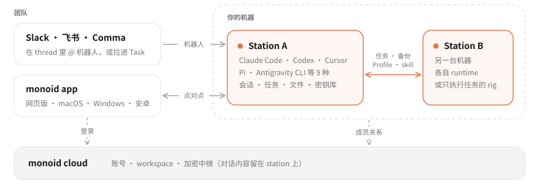

<a href="https://monoid.build/zh/"></a>

<p align="center">
<a href="https://monoid.build/zh/"><b>官网</b></a> ·
<a href="https://app.monoid.build"><b>网页版</b></a> ·
<a href="#下载">下载</a> ·
<a href="#开始使用">开始使用</a> ·
<a href="#工作原理">架构</a> ·
<a href="https://monoid.build/status">服务状态</a> ·
<a href="README.md">English</a>
</p>

<p align="center">
<a href="LICENSE"></a>


</p>

**monoid 把每台电脑上的 coding agent 连成一台。** 加入的每台电脑都在本地运行一个 **station**。各台 station 上登录的 agent（Claude Code、Codex、Cursor 等，共 [9 种](#agent-与模型服务商)）共用一个号池。团队在 Slack、飞书（Lark）、[Comma](https://comma.surf) 或 monoid 自己的对话里与它们协作，随时在任意设备上接手。对话、文件和后台任务都留在你的 station 上，客户端点对点直连。

## 核心能力

- **一个号池，额度一点不浪费。** 同一 workspace 内各台 station 上登录的账号组成统一号池。新对话优先分配给有所选模型、状态正常、最快重置且剩余额度最多的账号，并支持按账号设置并发上限、排队及自动回退到 API key 或 Vertex AI。对话中途换号时，agent 自动读回历史记录。
- **一个人开口，整个团队接着干。** 在 Slack thread 或飞书（Lark）群里 @ 机器人，把 station 的 agent 拉进 Comma Task，或在 app 里新建对话。workspace 内所有成员共享同一份对话、station、后台任务、团队记忆（`MEMORY.md`）、预设与 skill，也能生成端到端加密的只读分享链接给外部查看单个对话。
- **几台电脑合成一台。** station 支持 macOS、Linux、Windows 与 Docker。agent 可跨 station 派发任务或开启对话，只增量同步改动的文件，并在 mesh 内借用 Profile 与 skill。支持仅执行任务的 station（**rig**，由所有者签名授权）、Google Colab GPU 沙箱，以及在 station 之间在线迁移对话与账号。
- **随时随地用你的电脑和设备。** 浏览与分享文件、查看并操控 station 的桌面或浏览器、打开远程终端（测试版），或在 app 卡片里完成 CLI 工具登录。支持经 adb 挂载 USB 设备，挂载串口（macOS 与 Linux）或网络设备，也可以把 Android 手机借给 agent（agent 在独立虚拟屏上测试，不打扰你正常使用手机）。
- **会话一直在，丢机不丢记录。** 每个对话保留自己的工作目录、历史和记忆。构建、监控、定时任务和网页预览在当前轮结束后作为后台任务继续运行，完成后自动回报。对话通过加密 mesh 自动备份到同 workspace 的另外两台 station，也支持端到端加密备份到你自己的 R2/S3 对象存储。
- **点对点连接，数据留在本地。** 客户端通过 [iroh](https://github.com/n0-computer/iroh) 连接 station，局域网内直连，跨网走端到端加密中继，无需开放入站端口或配置 VPN。对话和文件留在你的 station 上，不进入云端数据库。
- **可选安全模式与密钥库。** 开启安全模式后，workspace 的成员、设备和 station 都必须经受信任设备签名批准，仅凭云端无法授予访问权限。密钥库加密保存 API key 与网站登录态，经人批准才交给 agent 使用。

## agent 与模型服务商

可以使用各 runtime 自己的订阅账号，也可以填服务商 API key 或连接本地模型服务。

| 类别 | 支持范围 |
| --- | --- |
| **agent runtime（9 种）** | Claude Code、Codex、Cursor、Devin、Grok Build、DeepSeek Harness、Hermes Agent、Antigravity CLI、Pi |
| **模型服务商与网关** | OpenAI、Anthropic、Google Gemini、Google Vertex AI、xAI、Mistral、DeepSeek、Qwen、Kimi / Kimi Code、Z.ai、MiniMax、Xiaomi MiMo、Ant Ling、OpenRouter、Vercel AI Gateway、OpenCode Zen / Go、Command Code、Open Design、Cloudflare AI Gateway、Azure OpenAI、Cloudflare Workers AI、Groq、Together AI、Fireworks、Cerebras、Hugging Face、NVIDIA、Baseten（含 Qwen、Kimi、Z.ai、MiniMax 中国区端点） |
| **本地与自定义端点** | Ollama、自定义 OpenAI 兼容或 Anthropic 兼容 HTTP 端点 |
| **GPU 沙箱** | Google Colab（G4、L4、T4），使用你自己的 Google Colab 账号 |

## 下载

| 平台 | 客户端 | 说明 |
| --- | --- | --- |
| **网页版** | [app.monoid.build](https://app.monoid.build) | 无需安装，支持 Linux、iPhone 与 iPad（可添加到主屏幕）。 |
| **macOS** | [下载](https://app.monoid.build/releases/latest/mac) | Apple 芯片桌面 App。 |
| **Windows** | [下载](https://app.monoid.build/releases/latest/win) | x64 桌面 App。 |
| **Android** | [下载](https://app.monoid.build/releases/latest/android) | 手机 App，支持虚拟屏共享调试。 |

目前免费。agent 使用你自己的订阅账号或 API key。

## 开始使用

1. 打开[网页版](https://app.monoid.build)或上面任一客户端，创建 workspace。
2. 选择「添加 station」，在要运行 agent 的电脑上执行页面生成的加入命令。

   **macOS（Apple 芯片）与 Linux（x64、arm64）：**

   ```sh
   curl -fsSL https://app.monoid.build/install.sh | sh -s -- <token>
   ```

   **Windows（x64，PowerShell）：**

   ```powershell
   & ([scriptblock]::Create((irm https://app.monoid.build/install.ps1))) <token>
   ```

   **Docker（x64、arm64）：**

   ```sh
   docker run -d --restart unless-stopped -v stillfail:/home/stillfail -e STILLFAIL_ORIGIN=https://app.monoid.build ghcr.io/afk-surf/stillfail-station <token>
   ```

3. 在该 station 上登录任一[支持的 agent](#agent-与模型服务商)，或添加服务商 API key，账号会自动加入号池。

   > [!NOTE]
   > 这些 runtime 及其账号独立于 monoid。agent 以该电脑的系统用户权限运行，加入机器前请先阅读[信任边界](SECURITY.md#trust-boundary)。

4. 在 app 里新建对话，或为 station 接入 Slack、飞书（Lark）或 Comma 机器人，在 thread 中 @ 它即可开始。

## 工作原理

<picture>
  <source media="(prefers-color-scheme: dark)" srcset="docs/images/architecture-zh-dark.svg">
  
</picture>

- **station（`station/`）**：运行在内置 Node 上的 TypeScript 服务，搭配预编译原生组件（Rust 编写的 launcher、runner、mesh、screen，以及 macOS 上的 Swift Helper）和 MoonBit 编写的读取与索引程序。它保持 agent 会话跨重启不中断，主动出站连接 Slack、飞书与 Comma，并将对话保存在本地 SQLite 中。除加密的 iroh mesh 外，外界没有任何入口可以连入 station。
- **workspace 与云端（`cloud/`）**：workspace 将成员与 station 组织在一起。云端（Cloudflare Workers 或自托管 `workerd`）仅承担账号系统职责：账号、workspace、成员凭证、station 名录和加密中继。对话内容从不进入云端数据库。
- **客户端（`apps/mbui/`、`client/core-ts/`）**：Android、iOS、macOS、Windows、Linux 与网页共用同一套 app，使用 MoonBit 和 `libs/ui`（`ui.monoid`）编写。各端共享 TypeScript 客户端 core（`client/core-ts/`），负责本地缓存 workspace 数据并通过 mesh 与各 station 同步。

## 仓库结构

| 路径 | 内容 |
| --- | --- |
| `station/` | station 服务（agent runtime、Slack / 飞书 / Comma、任务、文件、屏幕、密钥库）、原生组件（`station/native/`）、MoonBit 读取程序（`station/mb/`）与 Docker 镜像配置（`station/docker/`） |
| `client/` | 共享客户端 core（`core-ts/`）、Rust 原生外壳（`shell/`）、浏览器端 iroh（`iroh-wasm/`）与多语言文案（`i18n/`） |
| `apps/mbui/` | 跨平台客户端（Android、iOS、macOS、Windows、Linux、网页），基于 `libs/ui` 构建（[README](apps/mbui/README.md)） |
| `apps/extension/` | Chrome / Edge 浏览器扩展，可将网页、链接和选中文本发送到对话（[README](apps/extension/README.md)） |
| `libs/` | `ui`（mbui 框架与组件库）、`comma-ui`、`base`（MoonBit 基础库）、`client-core` 与 `mesh-transport` |
| `pion/` | 进行中的 Pion 迁移工作区（`app`、`station`、`ui`、`client-core`、`rules`、`base`、`tools`） |
| `web/` | 网页版 mbui 宿主，以及登录、分享、预览与管理后台页面 |
| `website/` | 官网：[monoid.build](https://monoid.build) 与 [ui.monoid.build](https://ui.monoid.build) |
| `cloud/` | Cloudflare Workers 账号、workspace、中继、发布服务，以及[`workerd` 自托管方案](cloud/selfhost/README.md) |
| `rules/` | station、cloud 与 core 共用的安全锁与密钥库校验规则（MoonBit 编译为 JS，附 Tamarin 协议模型） |
| `shared/` | 跨包共享的 TypeScript 模块（安全锁、增量更新、发布签名、规则运行时） |
| `bin/` | station 启动脚本与管理 CLI |
| `scripts/` | 仓库检查、发布脚本与 CI 计划 |
| `design/` | 品牌素材与图标 |
| `docs/` | 开发与运维指南、架构图与发布说明（`docs/releases/`） |
| `test/` | 集成测试与浏览器测试 |
| `vendor/` | 打过补丁的第三方依赖源码 |

## 从源码构建

需要 Git、Python 3、Node.js 24+ 和 pnpm 10.33.0。运行 cloud 测试无需任何外部账号或部署凭据：

```sh
git clone https://github.com/AFK-surf/monoid.git
cd monoid
pnpm install --frozen-lockfile
cd cloud && pnpm install --frozen-lockfile && pnpm run types && pnpm test
```

- **本地完整环境与客户端构建**：[docs/development.md](docs/development.md) 介绍了工具链、带模拟登录的本地控制面、本地 `iroh-relay`、一次性 station 及各平台客户端构建方式。
- **自托管**：云端可脱离 Cloudflare 运行在 `workerd` 上，域名、中继与登录方式均由你自行配置，详见 [cloud/selfhost/README.md](cloud/selfhost/README.md) 与[生产环境自托管](docs/development.md#production-self-hosting)。

## 文档

- [开发环境](docs/development.md)与[贡献指南](CONTRIBUTING.md)
- [自托管云端](cloud/selfhost/README.md)：脱离 Cloudflare 在 `workerd` 上部署
- [运维](docs/operations.md)：维护者如何构建与部署托管服务
- [安全](SECURITY.md)：私下报告漏洞的方式与 station 信任边界
- [Linux 桌面控制](docs/linux-desktop-setup.md)：Linux station 共享桌面所需的系统组件
- [出站防火墙后的局域网连接](docs/station-lan-firewall.md)：为受防火墙限制的 station 固定 mesh 端口

## 隐私与遥测

still.fail 和 monoid 的官方版本默认发送以下诊断数据：

| 类型 | 发送方 | 发送内容 | 关闭方式 |
| --- | --- | --- | --- |
| **使用统计与错误报告**（PostHog） | 各端 app（仅在登录 still.fail 自己的云端时发送） | 程序里写定的操作名和页面类别计数（不含操作携带的任何内容或参数、输入文字、对话/station/文件名及消息内容）、闪退、卡顿和错误，以账号 ID 标识 | 在 app 设置中关闭「发送使用统计和错误报告」，关闭后该设备不再向 PostHog 发送任何数据，也不再发送链路追踪。 |
| **客户端请求链路追踪**（Google Cloud） | 各端 app（经所登录的官方云端转发，still.fail 或 monoid） | 操作名称、耗时、错误和账号 ID，以及云端附上的网络归属（运营商、国家、省份和城市，不含 IP 地址）；不含消息内容。启动读到开关前暂留本机并标记不记录。 | 在 app 设置中关闭「发送使用统计和错误报告」（只要 app 会发送追踪就显示该开关），关闭后云端仅保留该设备失败、被限流或很慢的请求。 |
| **station 请求链路追踪**（Google Cloud） | station | 默认仅发送失败或很慢的 mesh 请求 span，以及云端附上的网络归属（运营商、国家、省份和城市，不含 IP 地址）；不含消息内容。 | 在 `config.json` 中设置 `"telemetry": { "traces": false }`。 |
| **station 运行日志**（Google Cloud） | station | 脱敏后的运行日志（发送前去掉家目录路径、邮箱、密钥和引号内的文字），以及云端附上的网络归属（运营商、国家、省份和城市，不含 IP 地址） | 由 workspace 管理员在 station 设置的「诊断」中关闭，或在 `config.json` 中设置 `"telemetry": { "logs": false }`。 |

- station 发往 PostHog 的错误报告默认关闭，仅在 station 管理者开启后发送。
- 本项目不读取其他工具的账号来识别你的身份：station 读取所运行 agent runtime 的登录仅用于驱动 agent，并且只向本 workspace 的设备展示。
- 从本仓库自行构建的版本不含 PostHog key，不会发送使用统计与错误报告；登录官方云端时链路追踪仍适用上述同一开关。monoid 官方客户端连接 `app.monoid.build`。详见[隐私政策](https://monoid.build/privacy)。

## 状态

monoid 正在活跃开发中，尚未到达 1.0。版本号格式为 `0.1.<n>`，测试版跟随 `main`，正式版基于 [docs/releases](docs/releases) 中审阅过的发布说明发布。station、客户端和云端各自独立更新，所有改动保持新旧版本兼容。

## 许可

[MIT](LICENSE)。内置的第三方代码、依赖和第三方商标保留各自的许可，详见[第三方声明](THIRD_PARTY_NOTICES.md)。
